# Getting started with Applr

A fitted linear model with more than one predictor lives in more
dimensions than a scatterplot can show. The usual workaround,
`geom_smooth(method = "lm")`, quietly fits a *different*, simpler model
to the plotted variables, so the line on the screen is not the model you
summarized.

Applr draws the model you actually fit. Its core idea is the **slice**:
hold every predictor except one at a fixed value, and draw the model’s
predictions as that one predictor varies. Start by fitting an
[`lm()`](https://rdrr.io/r/stats/lm.html), then hand it to Applr.
Explore it with
[`autoplot()`](https://ggplot2.tidyverse.org/reference/autoplot.html),
or present it with polish and fine-grained control using
[`geom_slice()`](https://saundersg.github.io/Applr/reference/geom_slice.md).

``` r

library(Applr)
library(ggplot2)
```

## Explore with autoplot()

[`autoplot()`](https://ggplot2.tidyverse.org/reference/autoplot.html) on
an `lm` builds the whole plot in one call: the model’s own data as a
scatter, a fitted slice line with its confidence ribbon, and a subtitle
saying what the model is. It also prints
[`summary()`](https://rdrr.io/r/base/summary.html) to the console, so
you can refit, re-plot, and read the coefficients and R² in one step
(turn this off with `summary = FALSE`).

``` r

autoplot(lm(Petal.Length ~ Sepal.Length + I(Sepal.Length^2):Species, iris))
#> 
#> Call:
#> lm(formula = Petal.Length ~ Sepal.Length + I(Sepal.Length^2):Species, 
#>     data = iris)
#> 
#> Residuals:
#>      Min       1Q   Median       3Q      Max 
#> -0.72665 -0.15039  0.00562  0.16639  0.76639 
#> 
#> Coefficients:
#>                                     Estimate Std. Error t value Pr(>|t|)    
#> (Intercept)                         -3.79412    1.09932  -3.451 0.000731 ***
#> Sepal.Length                         2.04477    0.36389   5.619 9.51e-08 ***
#> I(Sepal.Length^2):Speciessetosa     -0.19763    0.02958  -6.680 4.75e-10 ***
#> I(Sepal.Length^2):Speciesversicolor -0.11503    0.03033  -3.793 0.000218 ***
#> I(Sepal.Length^2):Speciesvirginica  -0.09427    0.02987  -3.156 0.001944 ** 
#> ---
#> Signif. codes:  0 '***' 0.001 '**' 0.01 '*' 0.05 '.' 0.1 ' ' 1
#> 
#> Residual standard error: 0.262 on 145 degrees of freedom
#> Multiple R-squared:  0.9786, Adjusted R-squared:  0.978 
#> F-statistic:  1655 on 4 and 145 DF,  p-value: < 2.2e-16
#> Coloured the plot by `Species` - one slice line per level.
#>     To choose the colour, use 'mapping = aes(color = ...)'.
```

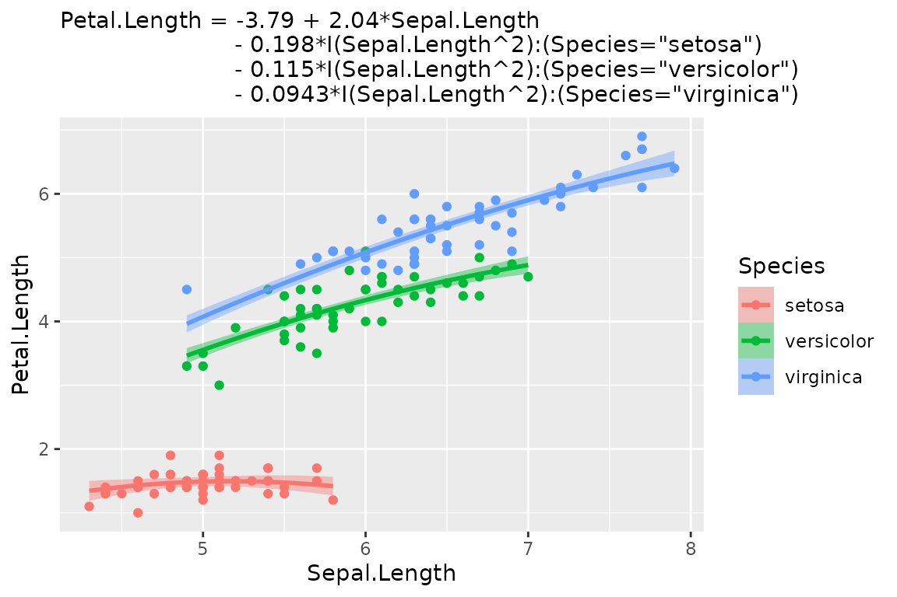

[`autoplot()`](https://ggplot2.tidyverse.org/reference/autoplot.html)
makes a few decisions for you. The model’s first numeric predictor goes
on the x-axis, and predictors that group into a few discrete values
become `color`, then facets. Every decision can be overridden. Pass a
`mapping` to change the defaults, just as you would with
[`ggplot()`](https://ggplot2.tidyverse.org/reference/ggplot.html);
whatever you leave out is still inferred. Choose a different x-axis with
`aes(x = ...)`. Arguments in `...` pass through to
[`geom_slice()`](https://saundersg.github.io/Applr/reference/geom_slice.md),
so `interval = "prediction"` gives the wider ribbon and
`interval = "none"` a bare line.

``` r

model <- lm(hwy ~ displ + drv + cyl, data = mpg)

autoplot(model, aes(color = factor(cyl))) + facet_wrap(~drv)
#> Faceted the plot by `drv` - one panel per level.
#>     For a single panel, drop `drv` from the model.
```

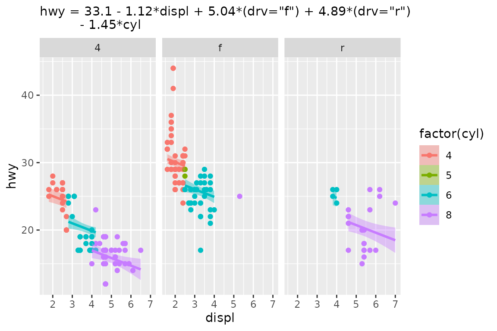

``` r


autoplot(model,
         aes(x = cyl, color = factor(drv)),
         interval = "none") +
  labs(title = "The Same Model From a Different Angle")
#> Value for `displ` not specified - Used mean: 3.472
#>     To choose a slice, use 'predict_vars = list(displ = 3.472)'.
```

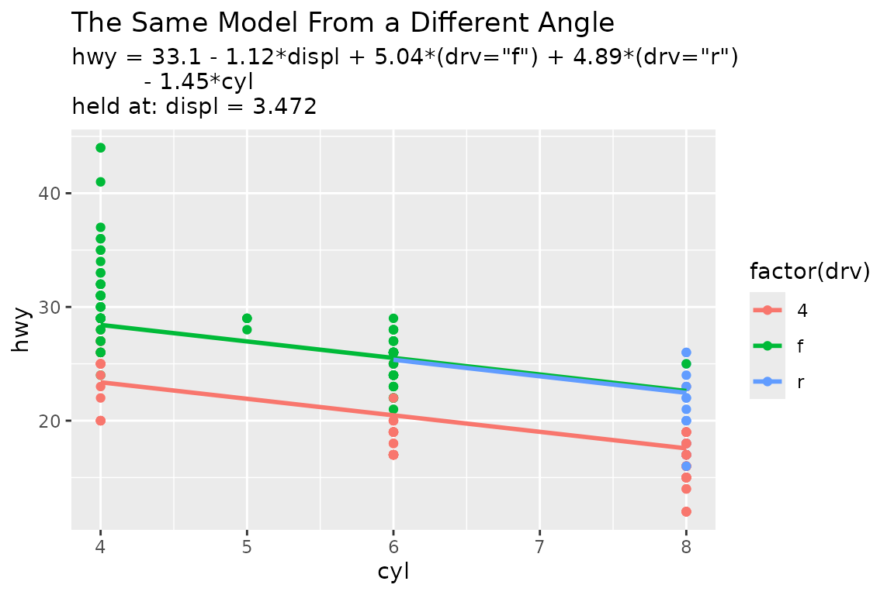

The result is an ordinary ggplot, so `+` works as usual.

## Present with geom_slice()

[`geom_slice()`](https://saundersg.github.io/Applr/reference/geom_slice.md)
is the layer underneath
[`autoplot()`](https://ggplot2.tidyverse.org/reference/autoplot.html).
It looks like
[`geom_smooth()`](https://ggplot2.tidyverse.org/reference/geom_smooth.html),
but where
[`geom_smooth()`](https://ggplot2.tidyverse.org/reference/geom_smooth.html)
fits its own model to the plotted data,
[`geom_slice()`](https://saundersg.github.io/Applr/reference/geom_slice.md)
draws the model *you* fitted, reading the plot’s
[`aes()`](https://ggplot2.tidyverse.org/reference/aes.html) to learn
which predictor is on the x-axis. Unlike
[`autoplot()`](https://ggplot2.tidyverse.org/reference/autoplot.html),
it makes as few decisions as it can.

Once a model has more than one predictor, each line is a 2-D slice
through it. Every predictor not on the x-axis has to be held at some
value, and
[`geom_slice()`](https://saundersg.github.io/Applr/reference/geom_slice.md)
fills those values in this order:

- Variables named in `predict_vars` are held at your chosen values.
- Variables mapped to a grouping aesthetic (`aes(color = g)`) are held
  at each group’s value, giving one line per group.
- Facet variables are held at each panel’s value.
- Anything left over is imputed (mean for numeric, most common value for
  factors), with a console message naming the value used.

The model below has four predictors and was fitted exactly, with no
noise. A bare
[`geom_slice()`](https://saundersg.github.io/Applr/reference/geom_slice.md)
has to impute three of them, and the console messages report each
choice:

``` r

set.seed(123)
n <- 80
x <- runif(n, 0.1, 10)
x2 <- runif(n, 0.1, 10)
x3 <- sample(c(1, 20, 40), n, replace = TRUE)
x4 <- sample(c(1, 2), n, replace = TRUE)
y <- log(5 + x + x2 + x3 + 1/5 * x * x3 + 80 * x4) # no random noise
dat <- data.frame(x, x2, x3, x4, y)

model <- lm(exp(y) ~ x*x3 + x2 + x4, data = dat)   # exact model fit

ggplot(dat, aes(x, y)) +
  geom_point() +
  geom_slice(model) +
  labs(title = "A Perfectly Fit Model 'Slice'")
#> Value for `x3` not specified - Used mean: 19.36
#>     To choose a slice, use 'predict_vars = list(x3 = 19.36)'.
#> Value for `x2` not specified - Used mean: 4.981
#>     To choose a slice, use 'predict_vars = list(x2 = 4.981)'.
#> Value for `x4` not specified - Used mean: 1.412
#>     To choose a slice, use 'predict_vars = list(x4 = 1.412)'.
#> Predictions of `exp(y)` were back-transformed to match the `y` axis.
#>     To turn this off, use 'back_transform = FALSE'.

# The same model against its full linear predictor: an exact fit
ggplot(dat, aes(x = log(5 + x + x2 + x3 + 1/5 * x * x3 + 80 * x4), y)) +
  geom_point() +
  geom_slice(model) +
  labs(title = "Same Model, Different X-Axis")
#> Predictions of `exp(y)` were back-transformed to match the `y` axis.
#>     To turn this off, use 'back_transform = FALSE'.
```

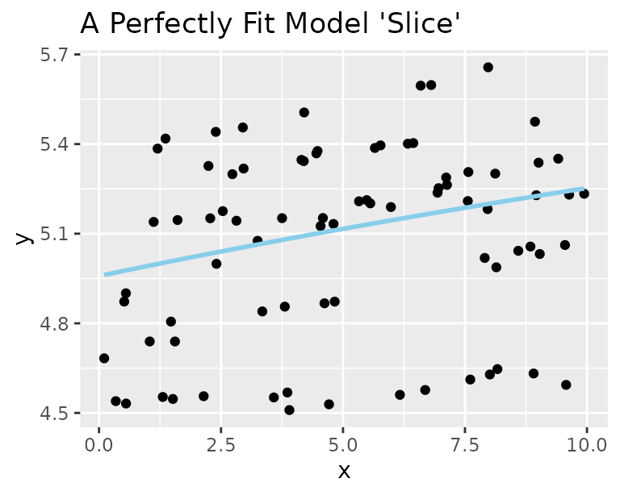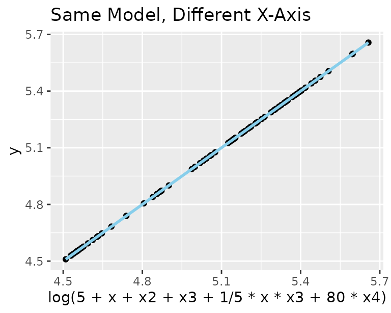

Notice that the response `exp(y)` was back-transformed onto the plotted
`y` axis without being asked. Those imputations were forced, but you can
do better. Map `x3` to color, facet by `x4`, and show the reach of `x2`
as a band, and every line lands on its points:

``` r

ggplot(dat, aes(x, y, color = factor(x3))) +
  geom_point() +
  geom_slice(model, band = "x2", predict_vars = list(x2 = c(0, 10))) +
  facet_wrap(~x4) +
  geom_slice_text() +
  geom_slice_subtitle()
#> Predictions of `exp(y)` were back-transformed to match the `y` axis.
#>     To turn this off, use 'back_transform = FALSE'.
```

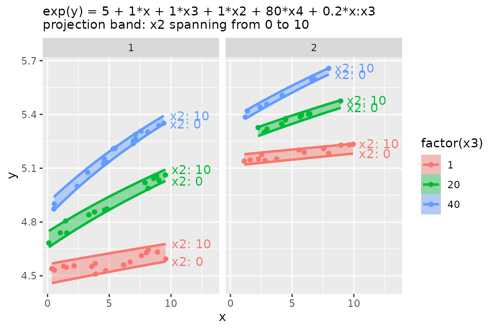

The rest of this vignette goes through those features one at a time.

### Choosing slices with predict_vars

Give a variable several values in `predict_vars` to draw one line per
value. Several multi-value variables are crossed.

``` r

model <- lm(Sepal.Length ~ Sepal.Width + Petal.Length, iris)

ggplot(iris, aes(Petal.Length, Sepal.Length)) +
  geom_point() +
  geom_slice(
    model,
    predict_vars = list(Sepal.Width = c(2, 3, 4)),
    interval = "confidence"
  ) +
  geom_slice_text()
```

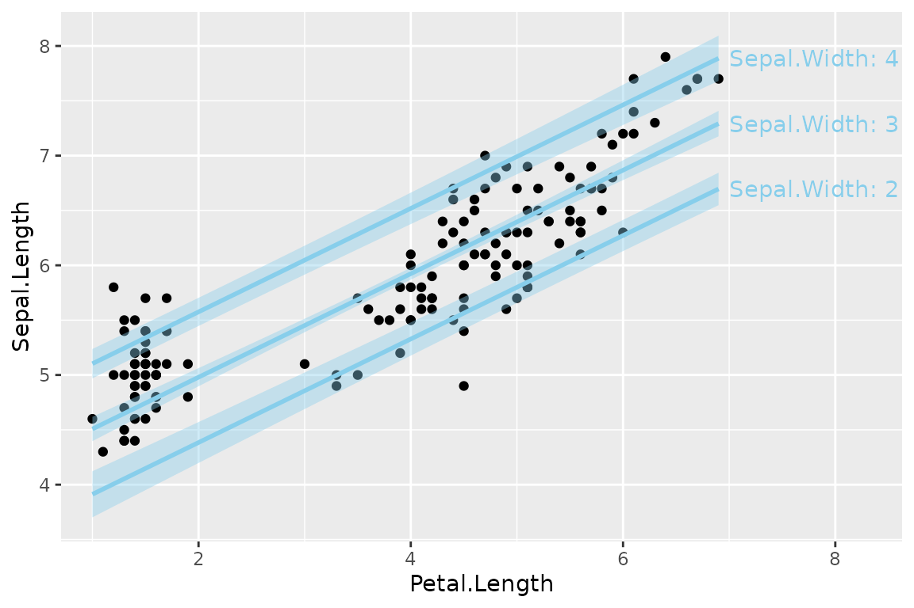

### Confidence and prediction intervals

`interval = "confidence"` or `"prediction"` shades the corresponding
[`predict.lm()`](https://rdrr.io/r/stats/predict.lm.html) interval
around each line:

``` r

model <- lm(hwy ~ displ + I(displ^2), data = mpg)

ggplot(mpg, aes(displ, hwy)) +
  geom_point() +
  geom_slice(model, interval = "confidence") +
  labs(title = "Confidence Interval")

ggplot(mpg, aes(displ, hwy)) +
  geom_point() +
  geom_slice(model, interval = "prediction") +
  labs(title = "Prediction Interval")
```

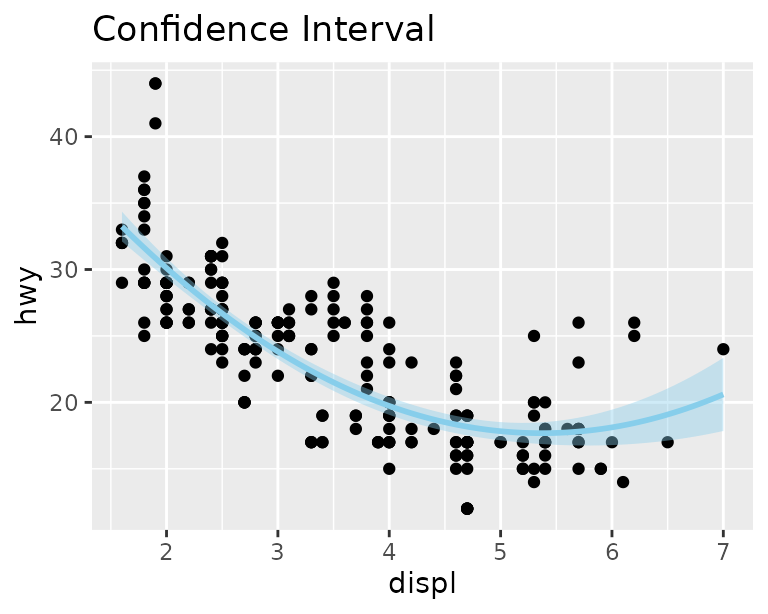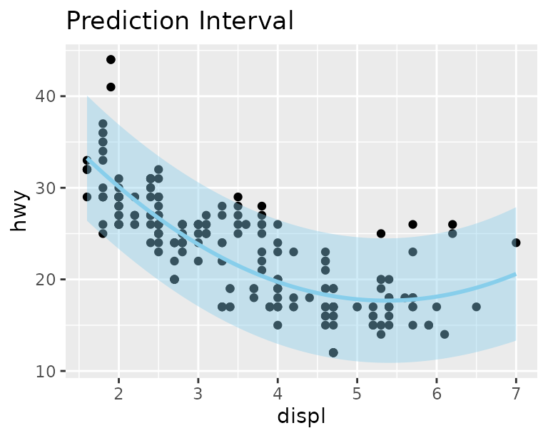

### Projection bands

An interval shows uncertainty. A `band` shows the *reach of a
predictor*: two edge slices with a translucent ribbon between them.
`band = "variable"` spans that predictor between the values given in
`predict_vars`, or across its observed range if `predict_vars` doesn’t
mention it. `band = TRUE` infers the variable when there is only one
sensible choice.

``` r

model <- lm(hwy ~ displ * drv + cyl, data = mpg)

# Inferred: cyl is the only predictor not shown, so it spans 4 to 8
ggplot(mpg, aes(displ, hwy, color = drv)) +
  geom_point() +
  geom_slice(model, band = TRUE) +
  geom_slice_text()
#> Band range for `cyl` not specified - used the min/max data range: 4 to 8.
#>     To choose the range, use 'predict_vars = list(cyl = c(4, 8))'.
```

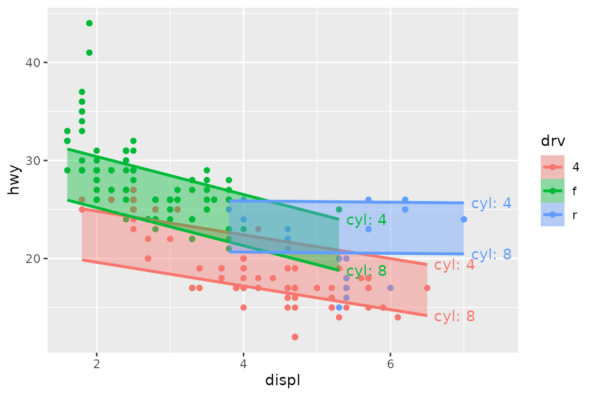

``` r


# Specified: cyl from 5 to 7
ggplot(mpg, aes(displ, hwy, color = drv)) +
  geom_point() +
  geom_slice(model, band = "cyl", predict_vars = list(cyl = c(5, 7))) +
  geom_slice_text()
```

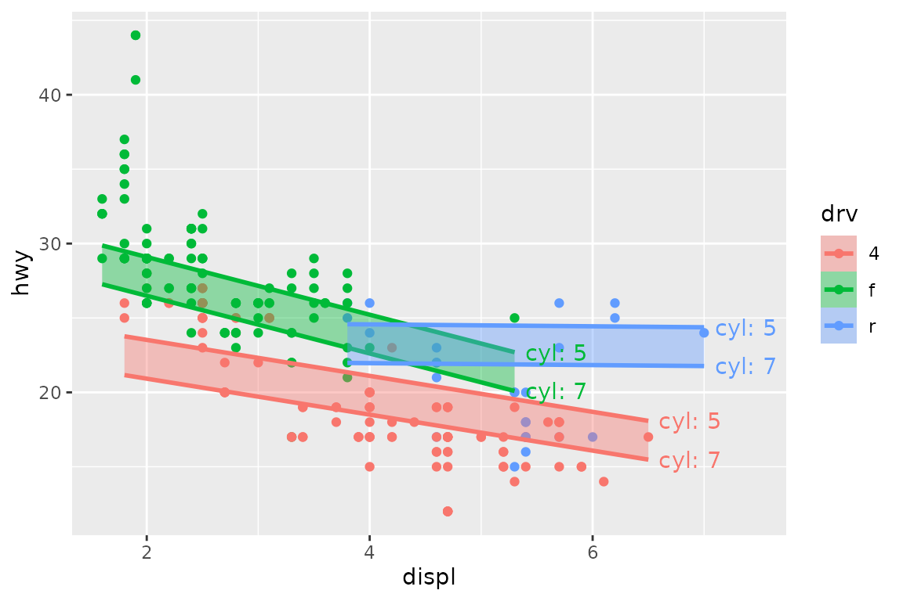

`band` cannot be combined with `interval`.

### Transformed responses

If the model’s response is transformed but the plot shows something
else, predictions are back-transformed to match the y-axis, and a
console message says so. Turn this off with `back_transform = FALSE`, or
pass a function or name (`exp`, `"log10"`, …) to override the
auto-detection.

``` r

model <- lm(log(mpg) ~ disp + hp, data = mtcars)

ggplot(mtcars, aes(disp, mpg)) +
  geom_point() +
  geom_slice(model) +
  labs(title = "normal y axis")
#> Value for `hp` not specified - Used mean: 146.7
#>     To choose a slice, use 'predict_vars = list(hp = 146.7)'.
#> Predictions of `log(mpg)` were back-transformed to match the `mpg` axis.
#>     To turn this off, use 'back_transform = FALSE'.

ggplot(mtcars, aes(disp, log(mpg))) +
  geom_point() +
  geom_slice(model) +
  labs(title = "log() y axis")
#> Value for `hp` not specified - Used mean: 146.7
#>     To choose a slice, use 'predict_vars = list(hp = 146.7)'.

ggplot(mtcars, aes(disp, mpg)) +
  geom_point() +
  geom_slice(model) +
  scale_y_log10() +
  labs(title = "scale_y_log10() axis")
#> Value for `hp` not specified - Used mean: 146.7
#>     To choose a slice, use 'predict_vars = list(hp = 146.7)'.
#> Predictions of `log(mpg)` were back-transformed to match the `mpg` axis.
#>     To turn this off, use 'back_transform = FALSE'.
```

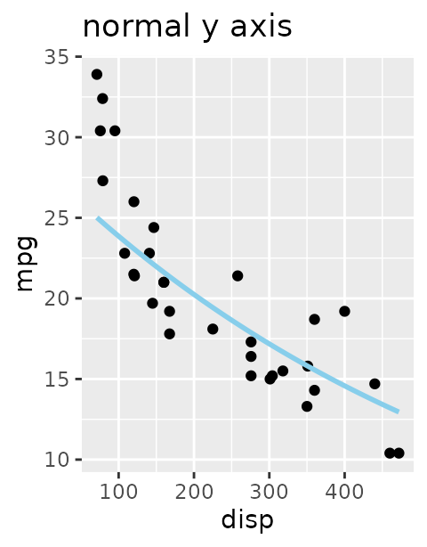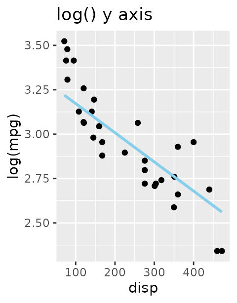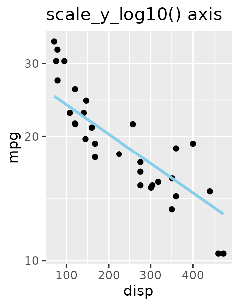

### Grouping: one line per group

With a grouping aesthetic, each group gets its own slice, and each line
stops at the end of its group’s data. `full_range = TRUE` extends every
line across the whole panel instead, like `fullrange` in
[`geom_smooth()`](https://ggplot2.tidyverse.org/reference/geom_smooth.html):

``` r

model <- lm(hwy ~ displ + I(displ^2) + displ:drv, data = mpg)

ggplot(mpg, aes(displ, hwy, color = drv)) +
  geom_point() +
  geom_slice(model)

ggplot(mpg, aes(displ, hwy, color = drv)) +
  geom_point() +
  geom_slice(model, full_range = TRUE)
```

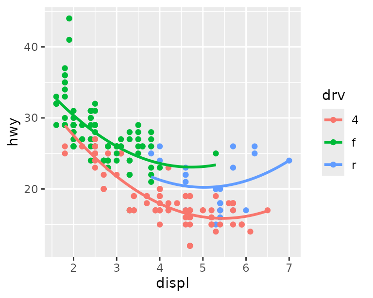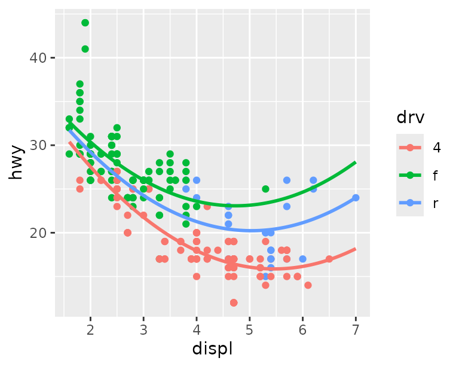

## Labeling the slices

Three companion layers describe the slices on the plot itself, so a
reader can tell which line is which and what was held constant. They
take no model; they read everything from the plot’s
[`geom_slice()`](https://saundersg.github.io/Applr/reference/geom_slice.md)
layers, so add them *after* those layers.

[`geom_slice_text()`](https://saundersg.github.io/Applr/reference/geom_slice_text.md)
labels the end of each line with the values that define it. It is most
useful with bands and multi-value `predict_vars`:

``` r

set.seed(123)
n <- 80
x <- runif(n, -10, 10)
x2 <- runif(n, 0, 4)
g <- factor(sample(c("A", "B"), n, replace = TRUE))
y <- x * ifelse(g == "A", 0.5, 2) + ifelse(g == "A", 5, -5) + 4 * x2 + rnorm(n)
dat <- data.frame(x, x2, g, y)
model <- lm(y ~ x * g + x2, data = dat)

ggplot(dat, aes(x, y)) +
  geom_point(alpha = 0.5) +
  geom_slice(model, predict_vars = list(x2 = c(0, 2, 4), g = c("A", "B"))) +
  geom_slice_text(style = "legend")
```

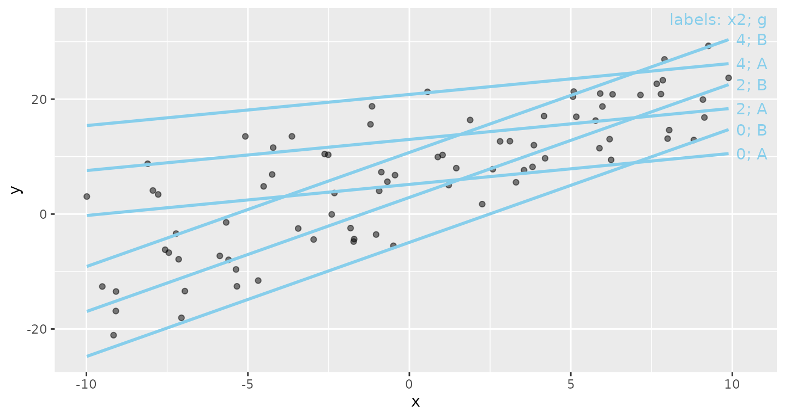

[`geom_slice_subtitle()`](https://saundersg.github.io/Applr/reference/geom_slice_subtitle.md)
(or
[`geom_slice_caption()`](https://saundersg.github.io/Applr/reference/geom_slice_caption.md))
writes the model equation and any held values that aren’t already shown
by the legend, facets, or
[`geom_slice_text()`](https://saundersg.github.io/Applr/reference/geom_slice_text.md).
It indents the equation when there’s room and compresses it when space
is tight.

``` r

model <- lm(Petal.Length ~ Sepal.Length + I(Sepal.Length^2):Species + Sepal.Width, iris)

ggplot(iris, aes(Sepal.Length, Petal.Length, color = Species)) +
  geom_point() +
  geom_slice(model, interval = "confidence") +
  geom_slice_subtitle()
#> Value for `Sepal.Width` not specified - Used mean: 3.057
#>     To choose a slice, use 'predict_vars = list(Sepal.Width = 3.057)'.
```

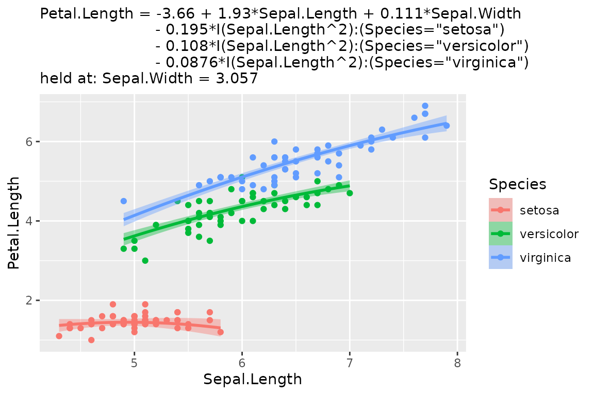

## Where to go next

- [`?geom_slice`](https://saundersg.github.io/Applr/reference/geom_slice.md)
  documents every option, including `n`, the number of points that make
  up each line.
- [`?geom_slice_text`](https://saundersg.github.io/Applr/reference/geom_slice_text.md)
  and
  [`?geom_slice_subtitle`](https://saundersg.github.io/Applr/reference/geom_slice_subtitle.md)
  cover label styles, placement, and `prepend`/`append` text.
- [`?slice_2d`](https://saundersg.github.io/Applr/reference/slice_2d.md)
  and
  [`?add_slice_2d`](https://saundersg.github.io/Applr/reference/add_slice_2d.md)
  draw the same slices in base graphics.
- [`?scatter_3d`](https://saundersg.github.io/Applr/reference/scatter_3d.md)
  (or `autoplot(model, type = "3d")`) shows a model with two numeric
  predictors as an interactive 3-D surface.
- [`?lm_equation`](https://saundersg.github.io/Applr/reference/lm_equation.md)
  and
  [`?lm_latex`](https://saundersg.github.io/Applr/reference/lm_latex.md)
  turn the fitted model into text or LaTeX for reports, and
  [`?diagnose`](https://saundersg.github.io/Applr/reference/diagnose.md)
  draws the standard residual plots.
